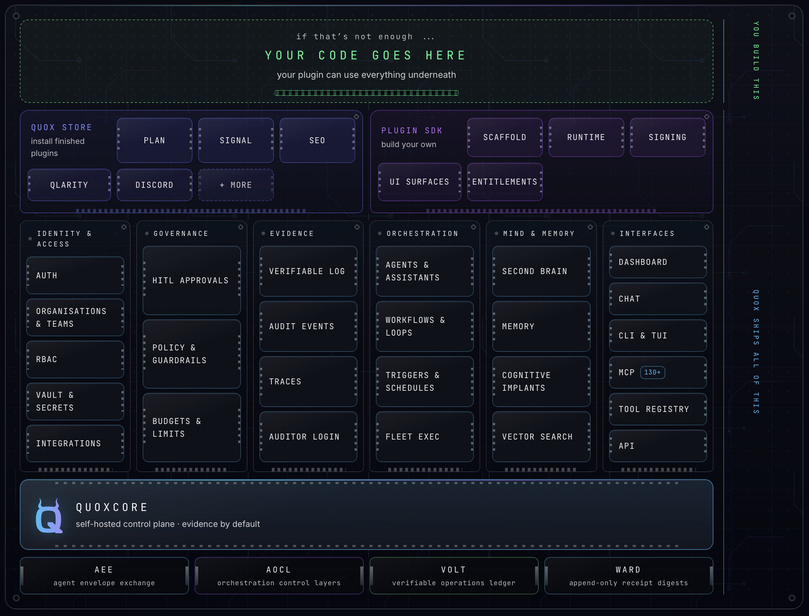

<div align="center">

# QuoxCORE

**A self-hosted control plane for AI agents. Evidence by default.**

You don't have to trust it. You can check it.

[](LICENSE)
[](VERSION)



[Install](#install) · [What you get](#what-you-get) · [Extend it](#extend-it) · [Licence](#licence) · [quox.ai](https://quox.ai)

</div>

---

QuoxCORE runs AI agents, workflows and tools on your own hardware, with a human approval step for anything risky and a tamper-evident record of what each agent did. It is free to self-host, for personal and business use.

This repository is the public release mirror of QuoxCORE. Development happens in a private repository; each release is exported here with a fresh history. Issues are welcome here. See [Contributing](CONTRIBUTING.md) for why pull requests to core are not accepted.

## Install

You need Docker with Compose and Git. Plan for 8 GB of RAM and 30 GB of free disk: the installer pulls prebuilt images from `ghcr.io/quoxai` (retrying up to 3 times on network errors) and, if the pull fails, falls back to building every image from source, which takes a while. Set `QUOX_IMAGES=build` to force a local build. It refuses to start below 4 GB of RAM or 10 GB of disk.

```bash
curl -fsSL https://get.quox.ai | sh
```

The installer clones this repository (which includes [QuoxFlow](quoxflow/)) and [QuoxMCP](https://github.com/quoxai/quoxmcp), generates secrets, builds the stack and waits for it to report healthy. Read it first if you prefer: [install.sh](https://get.quox.ai).

Manual install:

```bash
git clone https://github.com/quoxai/quoxcore.git quox
cd quox
./scripts/setup.sh
```

Then open `https://localhost:3000`, create the admin account in the setup wizard, and connect at least one model provider. An Anthropic, OpenAI or Google API key works on every install, and so does a Codex sign-in. A Claude sign-in needs the Claude CLI, which the prebuilt images do not include (it is not redistributed): build locally with `QUOX_IMAGES=build ./scripts/setup.sh` to use it. Until a provider is connected, agents cannot answer.

Setup also installs the `quox` command at `/usr/local/bin/quox` (or `~/.local/bin/quox` when it cannot write there). It runs the CLI that ships inside this install's collector image, so the host needs Docker only, not Node. Your profiles stay in `~/.config/quox`, it trusts this install's own certificate, and the `local` profile already points at `https://localhost:3000`. Pass `--no-cli` to setup to skip it. From the same terminal:

```bash
quox -p local setup                 # the setup wizard, in the terminal
quox -p local setup license link    # link this install to your Quox licence
```

Hosts you enrol (`quox fleet enrol <host>`) download the signed QuoxAgent from this install. Setup verifies that release (Ed25519 signature and pinned SHA-256 hashes) before building, and stops if verification fails. Offline, setup stops and names your options: put the release assets in a directory and set `QUOXAGENT_RELEASE_BASE_URL` to it, or set `QUOX_AGENT_RELEASE=skip` to install without host enrolment.

Verify the install:

```bash
./scripts/post-install-smoke.sh https://localhost:3000
```

Tested on: a clean Ubuntu 24.04 install test is in progress; results will be listed here.

## What you get

| Part | What it does |
|------|--------------|
| Dashboard | Web interface for agents, workflows, approvals, memory and settings |
| Collector | Agent runtime: chat, tool execution, plugins, evidence |
| Auth | Users, organisations, roles, the credential vault |
| QuoxFlow | Workflow engine with approval gates and an audit trail |
| Tasks and memory | Objectives, scheduled work and persistent agent memory |
| `quox` CLI | Terminal access to the same platform (`cli/`) |

Every agent action is wrapped in an envelope and written to an append-only record, so you can see who asked for what, which agent did it, what it touched and who approved it. The formats are open specifications:

- [AEE](https://github.com/quoxai/aee): the envelope every agent message travels in
- [AOCL](https://github.com/quoxai/aocl): the control layers a request passes through
- [VOLT](https://github.com/quoxai/volt): the operations ledger
- [WARD](https://github.com/quoxai/ward): write-once receipt digests that make the record tamper-evident
- [QuoxProof](https://github.com/quoxai/quoxproof): offline-verifiable receipts you can check without trusting us

Some parts are stable and some are beta or experimental. Per-area maturity pages (what works, what does not yet) will be published in this repository in a coming release.

## Extend it

Plugins, agents, connectors, workflows and skills you build through the documented interfaces are yours. You can publish or sell them under your own terms.

- Plugin SDK (Apache-2.0): [github.com/quoxai/quox-plugin-sdk](https://github.com/quoxai/quox-plugin-sdk)
- MCP tools: [QuoxMCP](https://github.com/quoxai/quoxmcp)
- Docs: [quox.ai/docs](https://quox.ai/docs)

## Licence

QuoxCORE is source-available under the [Quox Community Source Licence 1.0](LICENSE). It is not an open-source licence.

- Free: self-hosting for personal and commercial use, reading the source, building independent extensions.
- Not permitted without written agreement: modifying or redistributing the core, removing Quox branding, or offering Quox as a hosted, managed or white-label service.

See [COMMERCIAL-LICENSING.md](COMMERCIAL-LICENSING.md), [TRADEMARKS.md](TRADEMARKS.md) and the [licence FAQ](https://quox.ai/licensing).

## Security

Report vulnerabilities privately to security@quox.ai. See [SECURITY.md](SECURITY.md).

## Support

- Questions and bugs: [GitHub issues](https://github.com/quoxai/quoxcore/issues)
- Everything else: hello@quox.ai
